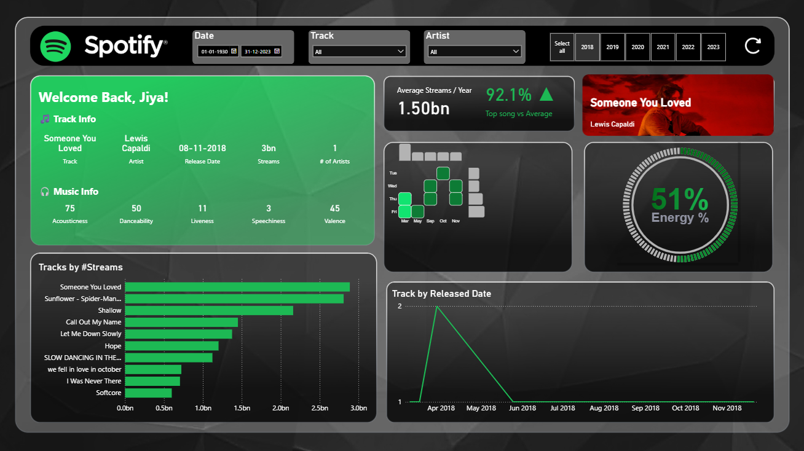

# Spotify Streaming Analytics Dashboard

A Power BI dashboard on the "Most Streamed Spotify Songs 2023" dataset, plus a small Python script that adds album cover URLs through the Spotify Web API and a script that reproduces the release-pattern numbers below.



## Problem

Which tracks dominate streaming, and what do release timing and audio features look like for popular tracks?

## Data

- `spotify-2023.csv`: 953 tracks, 24 columns (streams, release date, playlist and chart counts, BPM, key, danceability, valence, energy and similar).
- Source: "Top Spotify Songs 2023" on Kaggle. Check the Kaggle dataset page for its license before reusing the data.
- `updated_file.csv`: the same 953 rows plus an `image_url` column added by `SpotifyScript.py`. This is the file the Power BI report reads.
- Release years in the data run from 1930 to 2023, so this is not only a 2023 to 2024 snapshot. The data has release dates and total streams per track. It has no per-day listening data, so it cannot show when listeners stream.

## What was done

1. `SpotifyScript.py` looks up each track on the Spotify search endpoint and saves the album cover URL (Client Credentials flow, credentials from environment variables).
2. `Spotify_Dashboard.pbix` is the report. Its page contains: 1 bar chart, 1 line chart, 4 slicers, 5 card visuals, 2 Deneb custom visuals, 1 HTML content visual, plus layout shapes, a text box and a button.
3. `analyze_releases.py` computes the release statistics from the CSV.

## Key findings (output of `analyze_releases.py`)

| Finding | Value |
|:---|:---|
| Tracks in the dataset | 953 |
| Released on a Friday | 526 tracks, 55.2% |
| Share of all streams from Friday releases | 48.1% |
| Released in Q4 (Oct to Dec) | 23.9% |
| Releases by quarter (Q1, Q2, Q3, Q4) | 29.5%, 29.4%, 17.2%, 23.9% |
| Busiest release months | January (134), May (128) |
| Top 10% of tracks (95) by streams | 36.6% of all streams |

Friday is the most common release day (New Music Friday), but the statistics describe release dates of tracks in this dataset, not listening behaviour. The dataset does not support a Q4 release peak.

## How to run (Windows)

Dashboard: install Power BI Desktop and open `Spotify_Dashboard.pbix`. If asked, point the data source to `updated_file.csv` (Transform data, Data source settings).

Release statistics:

```bat
git clone https://github.com/JIYA1220/Spotify-dashboard.git
cd Spotify-dashboard
python -m venv .venv
.venv\Scripts\activate
pip install -r requirements.txt
python analyze_releases.py
```

Optional cover-art refresh (needs your own Spotify developer app):

```bat
copy .env.example .env
rem edit .env and fill in SPOTIFY_CLIENT_ID and SPOTIFY_CLIENT_SECRET
python SpotifyScript.py
```

Never commit `.env`.

## Limitations

- The `.pbix` cannot be diffed or tested here. The visual list above comes from its saved layout, not from a rendered check of each chart.
- The dashboard's DAX measures were not re-verified for this cleanup.
- Cover-art lookup takes the first search hit for each track and may match the wrong version. Rows with no match are stored as `Not found`.
- Dataset covers one year's most-streamed list, so it is biased toward already popular tracks.

Spotify name and brand assets belong to Spotify AB. Dataset used for educational and portfolio analytics.
